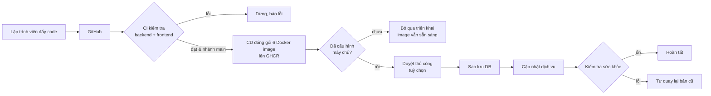

# Hướng dẫn triển khai & CI/CD — VaxClinic

Repo (private): https://github.com/Gachienmam88/vaxclinic-kiotviet · Actions: https://github.com/Gachienmam88/vaxclinic-kiotviet/actions

## 1. Giải thích ngắn cho chủ doanh nghiệp

**CI/CD là gì?** Giống quy trình kiểm định lô vắc xin trước khi nhập kho: mỗi lần lập trình viên gửi code mới,
GitHub tự động **kiểm tra** (CI), rồi **đóng gói** thành "kiện hàng" chuẩn (Docker image), và khi đã có máy chủ thì
tự **triển khai** lên máy chủ — có **sao lưu dữ liệu trước**, **kiểm tra sức khỏe** sau, và **tự quay lại bản cũ** nếu bản mới lỗi.
Không ai phải làm tay, không quên bước nào, và mọi lần chạy đều có nhật ký xem lại được.

```
 Lập trình viên        GitHub (kho code riêng tư)
 ┌──────────┐ đẩy code ┌──────────────────────────────────────────────────────────────┐
 │ máy dev  │ ───────▶ │ 1. CI KIỂM TRA  (mọi nhánh)                                  │
 └──────────┘          │    - Backend Java: biên dịch + chạy unit test               │
                       │    - Frontend: kiểm tra kiểu, lint, unit test, build thử    │
                       │        │ lỗi → dừng, báo đỏ ✗ (không đóng gói, không deploy)  │
                       │        ▼ đạt (chỉ nhánh main)                                 │
                       │ 2. CD ĐÓNG GÓI  6 image → kho GHCR (gắn mã commit + "main")  │
                       │        ▼                                                     │
                       │ 3. TRIỂN KHAI (chỉ khi đã khai báo máy chủ; chưa có → bỏ qua)│
                       └────────┼─────────────────────────────────────────────────────┘
                                ▼ SSH
                       ┌──────────────────────────────────────────────────────────────┐
                       │ MÁY CHỦ (VPS)                                                │
                       │  a. sao lưu tất cả database (pg_dump)                        │
                       │  b. tải image mới, khởi động lại dịch vụ                     │
                       │  c. kiểm tra sức khỏe 5 service + giao diện web              │
                       │  d. lỗi → tự quay lại bản trước; ổn → ghi nhận bản hiện hành │
                       └──────────────────────────────────────────────────────────────┘
```



### Đã chạy được / cần máy chủ
| Hạng mục | Trạng thái |
|---|---|
| Kho code riêng tư trên GitHub, nhánh `main` + nhánh phát triển | Đã có |
| CI tự kiểm tra mỗi lần đẩy code / mở pull request | Đã chạy |
| CD đóng gói image lên GHCR khi `main` thay đổi | Đã chạy |
| Triển khai lên máy chủ, sao lưu, kiểm tra sức khỏe, tự rollback | Đã viết sẵn — **chờ máy chủ** (hiện tự bỏ qua) |
| Tên miền + HTTPS | Cần máy chủ + tên miền |

## 2. Chi tiết kỹ thuật

| File | Vai trò |
|---|---|
| `.github/workflows/ci.yml` | CI: `mvn -B -ntp verify` (JDK 17 Temurin, cache Maven); frontend Node 22: `npm ci`, `tsc --noEmit`, `eslint . --quiet`, `node --test tests/*.test.mjs`, `next build`. Upload báo cáo test làm artifact. Hủy lần chạy cũ khi cùng nhánh có push mới. Không dùng secret. |
| `.github/workflows/cd.yml` | Chạy khi push `main` hoặc bấm tay. Gọi lại CI → build 6 image song song (5 service + frontend) bằng `docker/build-push-action` có cache → push `ghcr.io/gachienmam88/vaxclinic-kiotviet-<service>:<sha>` và `:main` → job `deploy` (environment `production`). |
| `backend/Dockerfile` | Dùng chung cho mọi service (`--build-arg MODULE=...`). |
| `frontend/Dockerfile` | Multi-stage, user `node` (không root), `next start -p 3000`. `NEXT_PUBLIC_*` là build-arg. |
| `infra/deploy/docker-compose.prod.yml` | Stack production: Postgres 16 + 5 service + frontend, image từ GHCR, giới hạn RAM (JVM 512 MB, `-Xmx256m`, gateway 384 MB), cổng chỉ mở `127.0.0.1`. Redis/RabbitMQ/MinIO chưa được code dùng nên không chạy. |
| `infra/deploy/deploy.sh` | Chạy trên máy chủ: khóa chống chạy trùng → `pg_dump -Fc` từng DB + globals vào `backups/<thời gian>-before-<tag>/` (giữ 20 bản) → `pull` + `up -d` → chờ `/actuator/health` của 5 service và `/login` của frontend (tối đa 300 s) → thành công: ghi `.current_tag`, `.previous_tag`; thất bại: in log, chạy lại tag trước, báo lỗi. Chạy lại cùng tag là an toàn. |

Image tag = mã commit (SHA) → biết chính xác bản nào đang chạy, quay lại bản nào cũng được.

**Lưu ý rollback:** rollback chỉ đổi image. Nếu bản mới đã chạy migration Flyway làm đổi cấu trúc DB, bản cũ có thể không
tương thích → khôi phục từ thư mục `backups/` (lệnh ở mục 4).

## 3. Thêm máy chủ (VPS) — làm 1 lần

**Cấu hình gợi ý:** Ubuntu 24.04, 2 vCPU, **4 GB RAM** (6 container Java/Node + Postgres ~3 GB), 40 GB SSD.

1. **Chuẩn bị máy chủ**
   ```bash
   curl -fsSL https://get.docker.com | sh                 # Docker + compose plugin
   sudo adduser --disabled-password deploy && sudo usermod -aG docker deploy
   sudo ufw allow OpenSSH && sudo ufw allow 80 && sudo ufw allow 443 && sudo ufw enable
   sudo mkdir -p /opt/vaxclinic && sudo chown deploy: /opt/vaxclinic
   ```
2. **Khóa SSH riêng cho GitHub** (trên máy của bạn): `ssh-keygen -t ed25519 -f vax_deploy -N ""` → nội dung
   `vax_deploy.pub` thêm vào `/home/deploy/.ssh/authorized_keys` trên VPS.
3. **File `.env` trên máy chủ** `/opt/vaxclinic/.env` (quyền `chmod 600`, KHÔNG đưa lên GitHub), theo mẫu `.env.example`:
   `DB_USER, DB_PASSWORD, JWT_SECRET (≥32 ký tự), ADMIN_USERNAME, ADMIN_PASSWORD, ENCRYPTION_KEY (base64 32 byte, không đổi sau khi có dữ liệu), COOKIE_SECURE=true`.
   Tạo giá trị ngẫu nhiên: `openssl rand -base64 32`.
4. **Secrets trên GitHub** (Settings → Environments → `production` → Add secret, hoặc Settings → Secrets → Actions):

   | Secret | Bắt buộc | Ví dụ / ghi chú |
   |---|---|---|
   | `DEPLOY_HOST` | có | IP hoặc tên miền VPS |
   | `DEPLOY_USER` | có | `deploy` |
   | `DEPLOY_SSH_KEY` | có | nội dung file `vax_deploy` (khóa riêng) |
   | `DEPLOY_PATH` | không | mặc định `/opt/vaxclinic` |
   | `DEPLOY_PORT` | không | mặc định `22` |
   | `DEPLOY_KNOWN_HOSTS` | nên có | kết quả `ssh-keyscan <host>` (chống giả mạo máy chủ) |

   Khi chưa có 3 secret bắt buộc, job deploy in thông báo "Deploy skipped" và kết thúc xanh.
5. **Duyệt thủ công (tuỳ chọn):** Settings → Environments → `production` → Required reviewers → chọn người duyệt.
6. **Tên miền + HTTPS** — Caddy tự xin chứng chỉ Let's Encrypt. Trỏ bản ghi A của tên miền về IP VPS, rồi:
   ```bash
   sudo apt install -y caddy
   sudo tee /etc/caddy/Caddyfile >/dev/null <<'EOF'
   app.ten-mien-cua-ban.vn {
       handle /api/payments/sepay/webhook { reverse_proxy 127.0.0.1:8080 }   # webhook SePay vào gateway
       reverse_proxy 127.0.0.1:3000
   }
   EOF
   sudo systemctl reload caddy
   ```
7. **Lần triển khai đầu:** Actions → CD → Run workflow (nhánh `main`). Admin được tạo tự động theo `ADMIN_USERNAME/PASSWORD`.
8. **Kéo image thủ công trên VPS** (ngoài pipeline) cần token GitHub có quyền `read:packages`:
   `echo <TOKEN> | docker login ghcr.io -u <github-user> --password-stdin`. Pipeline tự đăng nhập bằng token tạm của mỗi lần chạy.

## 4. Vận hành

- **Quay lại một bản cũ bằng tay:** Actions → CD → Run workflow → ô `tag` nhập SHA commit cũ (bỏ qua build, chỉ deploy).
- **Xem bản đang chạy:** `cat /opt/vaxclinic/.current_tag`.
- **Khôi phục 1 database từ bản sao lưu:**
  ```bash
  cd /opt/vaxclinic
  docker compose -f docker-compose.prod.yml --env-file .env exec -T postgres \
    pg_restore -U "$DB_USER" -d sales_db --clean --if-exists < backups/<thư-mục>/sales_db.dump
  ```
- **Sao lưu ra ngoài máy chủ:** `backups/` nằm trên chính VPS — nên đồng bộ thêm ra nơi khác (rclone lên Google Drive/S3) hằng ngày.
- **Log:** `docker compose -f docker-compose.prod.yml --env-file .env logs -f --tail=100 sales-service`.

## 5. Chi phí

- **GitHub Actions (repo private):** gói Free có 2.000 phút/tháng, 500 MB lưu trữ Packages + artifact; vượt thì tính theo phút
  (Linux ~0,008 USD/phút). Ước tính 1 lần CI ≈ 5–8 phút; 1 lần CD (CI + 6 image) ≈ 15–25 phút máy (các job chạy song song
  nhưng tính phút cộng dồn). Khoảng 40–60 lần đẩy code/tháng + vài lần lên `main` vẫn nằm trong gói miễn phí — cần theo dõi
  tại Settings → Billing. Repo public thì miễn phí hoàn toàn (không khuyến nghị cho hệ thống nội bộ).
- **GHCR:** mỗi bản phát hành ~6 image (Java ~200–300 MB/image, có lớp dùng chung). Chính sách tính phí lưu trữ GHCR do GitHub
  quy định và có thể thay đổi (image private có thể bị tính vào hạn mức Packages) → kiểm tra Settings → Billing, và định kỳ
  xoá các tag SHA cũ (giữ ~10 bản gần nhất).
- **VPS (tham khảo, chưa báo giá):** 4 GB RAM khoảng 150.000–400.000 đ/tháng tùy nhà cung cấp; tên miền `.vn` ~ 450.000–750.000 đ/năm.
