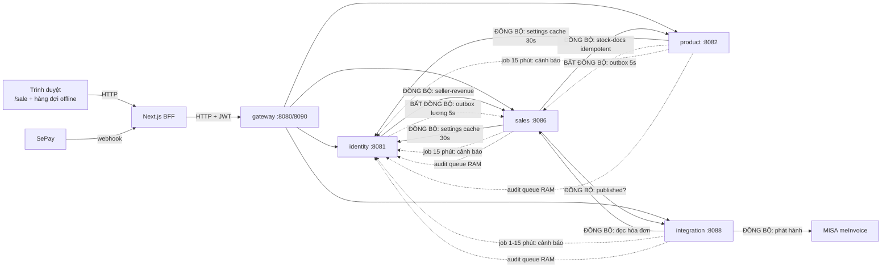
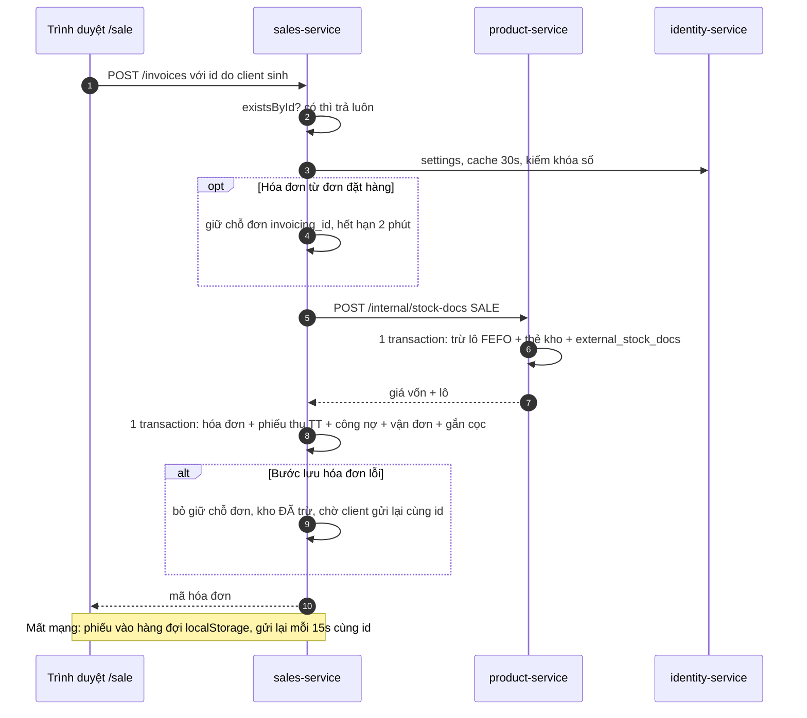
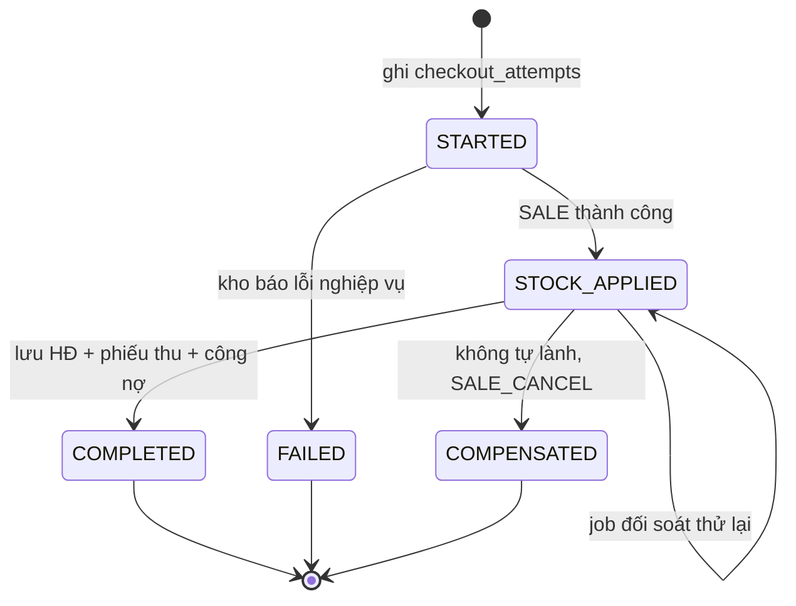
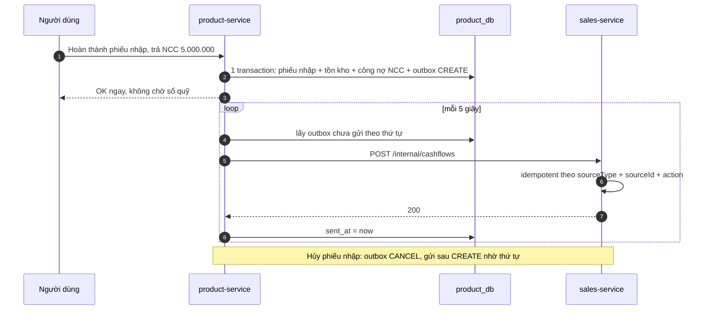
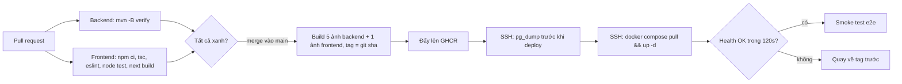

# Báo cáo kiến trúc: Đồng bộ / Bất đồng bộ, Redis, ElasticSearch, Saga, CI/CD

- Ngày: 2026-10-29 · Phạm vi: toàn bộ `backend/` + `frontend/` + `docker-compose.yml` (chỉ đọc code, không sửa)
- Bối cảnh vận hành: 1 phòng tiêm, 1 chi nhánh, ít người dùng đồng thời; máy ~16 GB RAM nhưng còn rất ít RAM trống.
- Cách đọc: mỗi phần có **"Nói ngắn gọn"** (cho chủ doanh nghiệp) và **"Chi tiết kỹ thuật"** (cho lập trình viên). Mọi nhận định về code hiện tại đều kèm đường dẫn file.

---

## 0. Tóm tắt cho chủ doanh nghiệp (đọc 1 phút)

1. Hệ thống hiện chia 5 "phần mềm con" (dịch vụ) nói chuyện với nhau qua mạng nội bộ. Phần lớn đã làm **đúng và đủ an toàn** cho quy mô 1 phòng tiêm: bán hàng gửi lại không bị trừ kho 2 lần, phiếu chi trả NCC/lương không bị mất, bán offline đồng bộ lại an toàn.
2. **Không cần thêm RabbitMQ, Redis, ElasticSearch lúc này.** Ba thứ này tốn RAM (tổng 0,3–2,5 GB) trong khi máy đang thiếu RAM, và chưa giải quyết vấn đề nào đang thật sự xảy ra. Ngược lại: RabbitMQ, Redis, MinIO **đang được bật trong docker-compose nhưng không dòng code nào dùng** → tắt đi để lấy lại RAM.
3. Có **3 việc nhỏ nên làm sớm** vì rủi ro thật: (a) các cuộc gọi giữa dịch vụ **không có giới hạn thời gian chờ** — 1 dịch vụ treo có thể làm treo quầy thu ngân; (b) khi tạo hóa đơn, nếu kho đã trừ mà bước lưu hóa đơn lỗi và nhân viên bỏ đi không bấm lại, **kho bị trừ mà không có hóa đơn** — cần 1 job đối soát nhỏ; (c) đăng nhập bằng mật khẩu **chưa giới hạn số lần thử sai**.
4. Tìm kiếm không dấu ("vac xin" ra "vắc xin") nên làm bằng **tiện ích có sẵn của PostgreSQL** (miễn phí RAM), không cần ElasticSearch.
5. Chưa có quy trình build/kiểm thử/triển khai tự động và **dự án chưa phải git repo** → bước đầu tiên là đưa code lên git riêng tư, sau đó dựng GitHub Actions + triển khai bằng docker compose trên 1 máy chủ (không cần Kubernetes).

---

## 1. Hiện trạng kiến trúc (đã kiểm chứng trong code)

### Nói ngắn gọn
Trình duyệt → web Next.js (giữ phiên đăng nhập) → cổng gateway → 4 dịch vụ nghiệp vụ, mỗi dịch vụ có kho dữ liệu riêng trong cùng 1 PostgreSQL.

### Chi tiết kỹ thuật

| Thành phần | Cổng | Trách nhiệm | Bằng chứng |
|---|---|---|---|
| gateway-service | 8080 trong `application.yml`/compose; **8090** khi chạy bằng script local | Định tuyến, kiểm JWT, chặn khi gian hàng bảo lưu (cache 2 s timeout) | `backend/gateway-service/src/main/resources/application.yml`, `scripts/start-all-local.ps1`, `backend/gateway-service/src/main/java/com/vaxclinic/gateway/StoreStatusFilter.java` |
| identity-service | 8081 | Người dùng, vai trò, thiết lập, nhân sự (lương, chấm công), thông báo, nhật ký thao tác, 2FA | `backend/identity-service/src/main/resources/application.yml` |
| product-service | 8082 | Hàng hóa, lô/HSD, thẻ kho, nhập hàng, NCC + công nợ NCC, bảng giá, phiếu kiểm/xuất kho | `backend/product-service/src/main/resources/application.yml` |
| sales-service | 8086 | Hóa đơn, trả hàng, đặt hàng, sổ quỹ, khách hàng, công nợ, giao hàng, báo cáo | `backend/sales-service/src/main/resources/application.yml` |
| integration-service | 8088 | HĐĐT MISA, hóa đơn đầu vào cổng thuế, webhook SePay, chứng thư số | `backend/integration-service/src/main/resources/application.yml` |
| PostgreSQL 16 | 5432 | 1 database / service (`identity_db`, `product_db`, `sales_db`, `integration_db`; `patient_db`, `clinical_db`, `report_db` đã tạo nhưng chưa dùng) | `infra/postgres/init-databases.sql` |
| Frontend Next.js 15 | 3000/3010 | BFF proxy `/api/backend/*` giữ JWT trong cookie httpOnly, tự refresh; màn `/sale` bán offline | `frontend/src/app/api/backend/[...path]/route.ts`, `frontend/src/features/sale/use-offline-queue.ts` |
| Redis / RabbitMQ / MinIO | 6379 / 5672 / 9000 | **Có trong compose, không được dùng.** Không pom nào có dependency amqp/redis/minio; không class Java nào tham chiếu | `docker-compose.yml`; grep `amqp|redis|minio` trong `backend/**/pom.xml` = 0 kết quả |

Lưu ý phụ (không nằm trong yêu cầu nhưng ảnh hưởng RAM): `backend/Dockerfile` chạy `java -XX:MaxRAMPercentage=75` mà compose **không đặt `mem_limit`** → mỗi container JVM được phép lấy tới 75% RAM máy. Script local thì đã giới hạn `-Xmx256m` (`scripts/start-all-local.ps1`). Khi chạy bằng Docker nên thêm `mem_limit` hoặc `-Xmx`.

---

## 2. Đồng bộ và bất đồng bộ

### 2.1 Nói ngắn gọn — quy tắc chọn

- **Đồng bộ (chờ trả lời ngay)**: khi người dùng đang đứng chờ và **câu trả lời phải đúng ngay lúc đó**. Ví dụ: thu ngân bấm thanh toán → phải biết ngay còn hàng/lô còn hạn không. Đổi lại: nếu dịch vụ kia chết thì thao tác này cũng thất bại (báo lỗi, thử lại).
- **Bất đồng bộ (ghi việc cần làm, làm sau vài giây)**: khi việc đó là **hệ quả phụ, chậm vài giây không sao**. Ví dụ: phiếu chi trong sổ quỹ khi trả tiền NCC, nhật ký thao tác, thông báo hộp thư, phát hành HĐĐT, số liệu báo cáo tổng hợp. Đổi lại: có khoảng thời gian ngắn dữ liệu 2 nơi chưa khớp ("nhất quán sau"), và cần cơ chế gửi lại + chống trùng.

| Câu hỏi | Nếu "có" → |
|---|---|
| Người dùng có cần kết quả này để quyết định bước tiếp theo ngay không? | Đồng bộ |
| Sai/thiếu kết quả có làm bán sai (âm kho, bán lô hết hạn, sửa HĐ đã phát hành)? | Đồng bộ |
| Chậm 5 giây – 15 phút có ai thiệt hại không? Nếu không | Bất đồng bộ |
| Bên nhận có thể đang tắt (bảo trì, khởi động lại) mà nghiệp vụ chính vẫn phải chạy? | Bất đồng bộ |
| Gọi ra **bên ngoài** (MISA, cổng thuế) — chậm, hay lỗi? | Bất đồng bộ hoặc đồng bộ có timeout + trạng thái "đang xử lý" |

### 2.2 Hiện trạng theo từng module (đã kiểm chứng)

| # | Luồng | Kiểu hiện tại | Mục đích | Bằng chứng | Đánh giá |
|---|---|---|---|---|---|
| S1 | sales → product `/internal/stock-docs` (bán, sửa, hủy HĐ, trả hàng, trả nhanh) | **Đồng bộ**, idempotent theo `(doc_id, doc_type)` | Trừ/hoàn kho theo lô FEFO, trả giá vốn | `backend/sales-service/src/main/java/com/vaxclinic/sales/invoice/ProductStockClient.java`; `backend/product-service/src/main/java/com/vaxclinic/product/internal/InternalStockService.java` (`apply`); bảng `external_stock_docs` trong `backend/product-service/src/main/resources/db/migration/V3__internal_stock_docs.sql` | **Đúng là phải đồng bộ.** Thiếu timeout; thiếu đối soát khi bước sau lỗi (xem §5) |
| S2 | sales/product → identity `/internal/settings` | Đồng bộ + cache 30 s trong bộ nhớ, lỗi thì dùng bản cũ / mặc định | Khóa sổ, cho phép âm kho, quy tắc đơn hàng | `backend/common-lib/src/main/java/com/vaxclinic/common/settings/ShopSettingsClient.java`; dùng ở `backend/sales-service/.../common/SalesRules.java`, `backend/product-service/.../stock/StockMovementService.java`, `.../purchase/PurchaseLineSupport.java` | Hợp lý. Rủi ro: gọi **bên trong transaction kho** của product khi cache hết hạn, không timeout |
| S3 | sales → integration `/internal/einvoices/{id}/published` | Đồng bộ, lỗi → **chặn** sửa/hủy (an toàn) | Không cho sửa/hủy HĐ đã phát hành HĐĐT | `backend/sales-service/.../common/SalesRules.java` (`checkEInvoiceNotPublished`) | Đúng là đồng bộ (cần câu trả lời đúng). Thiếu timeout |
| S4 | sales → integration `/internal/einvoices/statuses` | Đồng bộ, tải **toàn bộ** danh sách | Lọc danh sách HĐ theo trạng thái HĐĐT | `backend/sales-service/.../invoice/EInvoiceLookupClient.java` | Ổn với vài nghìn HĐĐT; khi > ~50k bản ghi sẽ chậm → nên chuyển sang sao chép trạng thái về sales (bất đồng bộ) |
| S5 | identity (HR) → sales `/internal/seller-revenue` | Đồng bộ, lỗi → báo "thử lại sau" | Tính hoa hồng trong bảng lương | `backend/identity-service/.../hr/commission/SellerRevenueClient.java`; gọi trong `.../hr/payroll/PayrollService.java` (method có `@Transactional`) | Chấp nhận được (người dùng chờ tính lương). Rủi ro nhỏ: giữ transaction DB trong lúc gọi HTTP không timeout |
| S6 | sales → product `GET /api/products/{id}` bằng JWT người dùng | Đồng bộ | Tỷ lệ quy đổi đơn vị cho "Trả nhanh" | `backend/sales-service/.../salesreturn/ProductCatalogClient.java` | Đúng là đồng bộ |
| S7 | integration → sales `/internal/invoices/{id}` rồi → MISA | Đồng bộ, do người dùng bấm "Phát hành" | Phát hành HĐĐT | `backend/integration-service/.../einvoice/EInvoiceService.java` (`publish`); nút ở `frontend/src/features/integrations/einvoice-status.tsx` | Chấp nhận được (người dùng bấm và chờ). Lỗi được ghi `FAILED` + job cảnh báo. Nên có timeout cho MISA |
| A1 | product → sales `/internal/cashflows` (phiếu chi trả NCC, hủy, sửa) | **Bất đồng bộ: outbox** trong `product_db`, job 5 s, gửi theo thứ tự, dừng ở bản lỗi đầu | Sổ quỹ có phiếu chi PC{mã phiếu nhập} | `backend/product-service/.../internal/CashflowOutbox.java`; bảng `outbox_cashflows` (V3) | **Tốt.** Bên nhận idempotent theo `(sourceType, sourceId, action)` (comment trong file + `backend/sales-service/.../cashbook/CashbookController.java` `/internal/cashflows`) |
| A2 | identity (HR) → sales `/internal/cashflows` (chi lương, tạm ứng) | Bất đồng bộ: outbox trong `identity_db` | Phiếu chi lương vào sổ quỹ | `backend/identity-service/.../hr/HrCashflowOutbox.java`; bảng `outbox_cashflows` trong `V4__hr_schema.sql` | Tốt (giống A1) |
| A3 | Mọi service → identity `/internal/audit-logs` | Bất đồng bộ: **hàng đợi trong RAM** (10.000), luồng nền gửi lô 200, lỗi thì gửi lại | Nhật ký thao tác | `backend/common-lib/src/main/java/com/vaxclinic/common/audit/HttpAuditLogger.java` | Đủ dùng. **Mất bản ghi nếu tắt service khi hàng đợi chưa gửi** (chính file đã ghi nhận). Nếu nhật ký cần giá trị pháp lý → chuyển sang outbox DB |
| A4 | product/sales/integration → identity `/internal/notifications/sync` | Bất đồng bộ: job định kỳ (15 phút; SePay 1 phút), gửi **trọn bộ** trạng thái, identity tự chống trùng/đóng | Hộp thư cảnh báo: tồn thấp/HSD, công nợ, HĐĐT lỗi, nhận chuyển khoản | `backend/common-lib/.../notification/NotificationClient.java`; `backend/product-service/.../notification/StockAlertJob.java`; `backend/sales-service/.../notification/SalesAlertJob.java`; `backend/integration-service/.../notification/IntegrationAlertJob.java`; `.../storeprofile/CertificateExpiryAlerts.java` (6 h) | **Rất hợp với quy mô này** (trạng thái tự sửa, không cần broker) |
| A5 | identity jobs: tự tạo/cập nhật bảng lương (6 h), tự chấm công (1 h), dọn thông báo (24 h) | Job nội bộ `@Scheduled` | Tự động hóa nhân sự | `backend/identity-service/.../hr/HrJobs.java`; `.../notification/NotificationWriter.java` | Ổn với 1 instance. Chạy 2 instance sẽ chạy trùng (cần khóa job) |
| A6 | SePay → (BFF) → integration webhook | Bên ngoài gọi vào; idempotent `on conflict (sepay_id) do nothing` | Ghi nhận chuyển khoản, khớp mã yêu cầu thanh toán | `backend/integration-service/.../payment/SePayController.java`; proxy `frontend/src/app/api/payments/sepay/webhook/route.ts` | Tốt, chống trùng bằng ràng buộc DB — **không cần Redis** |
| A7 | Màn `/sale` offline → hàng đợi `localStorage` → POST `/invoices`, `/sales-returns`, `/orders` | Bất đồng bộ phía trình duyệt; id do client sinh; đồng bộ khi có mạng + mỗi 15 s; lỗi nghiệp vụ giữ lại cho nhân viên | Bán khi mất mạng | `frontend/src/features/sale/use-offline-queue.ts`, `frontend/src/features/sale/sale-storage.ts`; server bỏ qua bản trùng: `InvoiceService.create` (`existsById`), `InvoiceWriter.persist` (kiểm lại trong transaction) | Tốt. Kỳ khóa sổ được kiểm khi đồng bộ muộn (`InvoiceService.create` → `rules.checkNotLocked`) |

Không có `@Async`, `ApplicationEventPublisher`, `@TransactionalEventListener` hay message broker nào trong code (grep toàn `backend/`).

**Vấn đề chung đã kiểm chứng: không client HTTP nội bộ nào đặt timeout.** Tất cả dùng `RestClient.builder().baseUrl(...).build()` không cấu hình request factory (`ProductStockClient`, `EInvoiceLookupClient`, `SalesRules`, `SellerRevenueClient`, `ProductCatalogClient`, `ShopSettingsClient`, `NotificationClient`, `HttpAuditLogger`, `CashflowOutbox`, `HrCashflowOutbox`, `EInvoiceService`). Chỉ gateway có `timeout(2s)` (`StoreStatusFilter.java:82`). Grep `Timeout|requestFactory` trong `backend/` chỉ ra đúng 1 kết quả đó.

### 2.3 Sơ đồ luồng dữ liệu hiện tại



Bản ASCII (nét liền `──▶` = đồng bộ, nét đứt `- - ▶` = bất đồng bộ):

```
 Trình duyệt (/sale, hàng đợi localStorage) ──▶ Next.js BFF ◀── SePay webhook
                                                   │
                                                   ▼
                                           gateway :8080/8090
            ┌───────────────┬─────────────────────┼──────────────────────┐
            ▼               ▼                     ▼                      ▼
     identity :8081   product :8082          sales :8086        integration :8088 ──▶ MISA
        ▲  ▲  ▲  │        │  ▲  │               │  │  │  ▲               │
        │  │  │  │        │  └──┼──stock-docs───┘  │  │  └──đọc hóa đơn──┘
        │  │  │  │        │     │ (đồng bộ)        │  └──published? (đồng bộ)──▶ integration
        │  │  │  └─seller-revenue (đồng bộ)───────▶│
        │  │  └────settings 30s (đồng bộ)◀─────────┘ (product cũng gọi)
        │  │
        │  └ - - cảnh báo 15 phút / audit queue - - (product, sales, integration)
        │
   product ─ - - outbox phiếu chi NCC (5 s) - - ▶ sales /internal/cashflows
   identity ─ - - outbox phiếu chi lương (5 s) - - ▶ sales /internal/cashflows
```

Luồng thanh toán tại quầy (hiện tại):



### 2.4 Chỗ cụ thể nên thay đổi (theo mức ưu tiên)

1. **Thêm timeout cho mọi `RestClient` nội bộ** (rủi ro thật, sửa rẻ). Hiện tại nếu product-service bị treo (GC dài, DB khóa), request bán hàng ở sales giữ luồng vô hạn; nghiêm trọng hơn, `StockMovementService` gọi `ShopSettingsClient.get()` khi cache hết hạn — nếu đúng lúc đó identity treo thì **transaction kho đang khóa dòng tồn kho cũng treo**, các quầy khác bán cùng mặt hàng phải chờ. Đề xuất: 1 factory chung trong `common-lib` (connect 2 s, read 5 s; MISA/cổng thuế 20–30 s), chỉ đổi chỗ khởi tạo client. `ProductStockClient` đã xử lý `ResourceAccessException` → thông báo "thử lại" sẵn có; vì idempotent nên thử lại là an toàn.
2. **Đối soát "kho đã trừ nhưng không có hóa đơn"** (xem §5.3) — job nhỏ, không cần broker.
3. **Nhật ký thao tác bền hơn** (tùy yêu cầu pháp lý): thay hàng đợi RAM bằng bảng `outbox_audit` trong DB của từng service, tái dùng đúng mẫu của `CashflowOutbox`. Chỉ cần nếu chủ cơ sở muốn nhật ký không mất khi khởi động lại.
4. **Trạng thái HĐĐT về phía sales** (khi > ~50k HĐĐT hoặc lọc danh sách > 1 s): integration ghi outbox "einvoice-status-changed" → sales lưu cột `einvoice_status`. Bỏ được S4 và có thể bỏ S3 (đọc cột cục bộ; nhưng S3 nên giữ đồng bộ nếu cần tuyệt đối đúng ngay sau khi vừa phát hành).
5. **Phát hành HĐĐT tự động sau khi bán** (nếu cần tính năng này): KHÔNG gọi MISA trong request thanh toán. Sales ghi outbox "invoice-completed" → integration phát hành nền, lỗi → `FAILED` + cảnh báo (đã có `IntegrationAlertJob`).
6. **Báo cáo tổng hợp** khi dữ liệu lớn: bảng tổng hợp theo ngày trong `sales_db` cập nhật bằng job đêm hoặc trong cùng transaction — **không phải việc của broker hay ES**.

### 2.5 Outbox + HTTP hiện tại đã đủ chưa, khi nào cần RabbitMQ?

**Đủ cho hiện tại.** Mẫu outbox trong code đã có những tính chất quan trọng: ghi cùng transaction nghiệp vụ (không mất), gửi lại đến khi thành công, giữ thứ tự (dừng ở bản lỗi đầu), bên nhận idempotent. Với vài chục phiếu chi/ngày, độ trễ 5 s là không đáng kể.

Hạn chế đã biết (chấp nhận được lúc này):
- Mỗi service tự viết vòng lặp gửi (2 bản gần như giống nhau: `CashflowOutbox`, `HrCashflowOutbox`) → nếu thêm outbox thứ 3 thì gom thành 1 lớp dùng chung trong `common-lib`.
- Không dọn bản ghi đã gửi (`sent_at is not null`) — nên xóa sau 90 ngày.
- 1 bản lỗi vĩnh viễn (vd. dữ liệu sai) sẽ **chặn cả hàng** (vì dừng ở bản lỗi đầu) — cần cảnh báo khi `attempts > N` (có thể đẩy vào hộp thư bằng `NotificationClient`).
- Chạy 2 instance cùng service sẽ gửi trùng (bên nhận idempotent nên không sai dữ liệu, nhưng nên dùng `select ... for update skip locked`).

**RabbitMQ đáng làm khi** (ít nhất 1 điều kiện):
- Có ≥ 3 bên cùng cần nghe 1 sự kiện (vd. "hóa đơn hoàn thành" → HĐĐT + báo cáo + hồ sơ tiêm chủng + tích điểm), lúc đó HTTP điểm-điểm thành mạng nhện.
- Nhiều chi nhánh / nhiều instance và lưu lượng > vài chục sự kiện/giây.
- Cần xử lý nặng tách khỏi request (import hàng nghìn dòng, đồng bộ cổng thuế hàng loạt) với nhiều worker.

**Chi phí thật:** RabbitMQ 3.13 + management ≈ 150–400 MB RAM thường trực; thêm 1 thứ phải giám sát (đầy đĩa, hàng đợi chết, mật khẩu), thêm dependency `spring-boot-starter-amqp` cho mỗi service (~20–40 MB heap mỗi JVM). **Vẫn cần outbox** (broker không thay được việc "ghi DB và gửi tin cùng lúc"), chỉ thay phần "vòng lặp HTTP" bằng "publish lên broker". Nghĩa là RabbitMQ không xóa được độ phức tạp hiện tại mà còn cộng thêm.

---

## 3. Redis

### Nói ngắn gọn
Redis là bộ nhớ tạm dùng chung giữa nhiều máy chạy cùng 1 dịch vụ. Hiện mỗi dịch vụ chỉ chạy **1 bản**, nên bộ nhớ trong chính dịch vụ đã đủ. **Chưa cần Redis**; container Redis đang chạy là thừa — tắt đi.

### Chi tiết kỹ thuật

| Nhu cầu | Hiện tại làm thế nào | Cần Redis khi nào |
|---|---|---|
| Cache thiết lập cửa hàng | Cache trong JVM 30 s (`ShopSettingsClient.java`); gateway cache trạng thái gian hàng (`StoreStatusFilter.java`) | Khi ≥ 2 instance và cần **xóa cache ngay** khi đổi thiết lập (hiện chấp nhận trễ ≤ 30 s — đủ) |
| Cache danh mục hàng | Màn `/sale` tải danh mục về trình duyệt và tìm cục bộ (`frontend/src/features/sale/use-sale-catalog.ts`) | Gần như không cần; DB với vài nghìn mặt hàng trả lời < 50 ms |
| Giới hạn đăng nhập sai | **2FA có khóa theo DB** (`identity/auth/twofactor/TotpVerifier.java`, cột `failed_attempts/locked_until` trong `V8__store_owner_2fa_terms.sql`); **đăng nhập mật khẩu không có giới hạn** (không tìm thấy logic đếm trong `identity/auth/AuthService.java`) | Với 1 instance: đếm trong DB (giống TOTP) hoặc bộ đếm trong RAM là đủ. Redis chỉ cần khi ≥ 2 instance identity |
| Thu hồi refresh token | Đã lưu hash trong bảng `refresh_tokens`, xoay vòng + thu hồi khi phát hiện dùng lại (`AuthService.java`, `RefreshToken.java`) | Không cần. Access token 30 phút; nếu cần thu hồi access token tức thì → danh sách đen ngắn hạn, Redis chỉ hợp lý khi nhiều gateway |
| Khóa job định kỳ | 1 instance → không cần | ≥ 2 instance: dùng **ShedLock với bảng PostgreSQL** (không cần Redis) hoặc `pg_try_advisory_lock` |
| Chống trùng SePay | Ràng buộc `on conflict (sepay_id) do nothing` (`SePayController.java`) | Không cần — DB là nơi đúng |
| Giữ chỗ đơn đặt hàng | Cột `invoicing_id/invoicing_at` + UPDATE có điều kiện (`OrderDepositLedger.depositForInvoice`, `V8__order_invoicing_claim.sql`) | Không cần — đúng và bền hơn khóa Redis |

**Nếu sau này dùng Redis**, cần sửa: thêm `spring-boot-starter-data-redis` vào các service liên quan; `ShopSettingsClient` đọc qua `@Cacheable` + kênh pub/sub để xóa cache khi identity lưu thiết lập; bộ đếm đăng nhập sai `INCR login:fail:{username}` + `EXPIRE`; cấu hình `REDIS_URL` trong compose; đặt `maxmemory 64mb` + `maxmemory-policy allkeys-lru`. RAM: Redis rỗng ~5–10 MB, thực tế < 50 MB — **rẻ về RAM**, cái giá chính là thêm 1 điểm lỗi và code xử lý khi Redis mất.

**Ngưỡng nên làm:** chạy ≥ 2 instance của identity hoặc gateway (vd. thêm chi nhánh, cần không gián đoạn khi deploy).

---

## 4. ElasticSearch và lựa chọn nhẹ hơn

### Nói ngắn gọn
Tìm kiếm hiện dùng `ILIKE` (phân biệt dấu): gõ "vac xin" **không** ra "Vắc xin" ở các màn quản trị (riêng màn bán hàng đã bỏ dấu phía trình duyệt). Cách rẻ nhất: bật 2 tiện ích có sẵn của PostgreSQL (`unaccent`, `pg_trgm`) — không tốn thêm RAM đáng kể. ElasticSearch cần **≥ 1–2 GB RAM** — không phù hợp máy hiện tại.

### Chi tiết kỹ thuật

Bằng chứng: tìm kiếm dùng `ilike` tại `product/product/ProductListQuery.java`, `product/pricebook/PriceBookRowQuery.java`, `sales/customer/CustomerListQuery.java`, `identity/audit/AuditLogController.java`, `identity/hr/employee/EmployeeService.java`, `integration/inputinvoice/InputInvoiceController.java`. Không migration nào có `CREATE EXTENSION`. Frontend bỏ dấu bằng `normalize("NFD")` trong `frontend/src/features/sale/use-sale-catalog.ts` và `frontend/src/lib/vn-admin-search.ts`.

| Use case | Khuyến nghị | Lý do |
|---|---|---|
| Tìm hàng/khách không dấu, gõ sai nhẹ | PostgreSQL `unaccent` + `pg_trgm`, cột sinh `search_text = lower(f_unaccent(name ‖ code ‖ phone))` + chỉ mục GIN trigram | Dữ liệu dưới 100k dòng → < 20 ms; 0 thành phần mới |
| Tìm nhật ký thao tác | Như trên trên `doc_code, detail` + **phân vùng theo tháng** khi > 5 triệu dòng | Truy vấn luôn có khoảng thời gian → chỉ mục `(created_at)` + trigram là đủ |
| Báo cáo tổng hợp (doanh thu, tồn) | Bảng tổng hợp / materialized view trong PostgreSQL | **Không phải việc của search engine** |
| Tìm toàn văn có xếp hạng, gợi ý gõ, nhiều chi nhánh, hàng triệu bản ghi | Meilisearch (~100–300 MB RAM) trước, ElasticSearch/OpenSearch sau | Meilisearch hỗ trợ tiếng Việt không dấu tốt, 1 binary, RAM thấp |

Khi cần search engine riêng, **đồng bộ dữ liệu bằng outbox → indexer**: service nguồn ghi `outbox_search(entity, id, op)` cùng transaction, job đọc và đẩy sang Meilisearch/ES (idempotent theo id), kèm lệnh "dựng lại toàn bộ chỉ mục". Không ghi đồng thời DB + ES trong request (2 nơi lệch nhau khi 1 bên lỗi).

**Ngưỡng chuyển** (cần ≥ 2 điều kiện): (a) > 1 triệu dòng cần tìm toàn văn trong 1 bảng; (b) p95 tìm kiếm > 300 ms **sau khi đã có chỉ mục trigram**; (c) cần xếp hạng liên quan/đồng nghĩa/gợi ý mà SQL làm không nổi; (d) có ≥ 2 GB RAM trống dành riêng.

---

## 5. Saga — giao dịch nghiệp vụ trải nhiều dịch vụ

### 5.1 Nói ngắn gọn
"Saga" là cách làm 1 việc lớn gồm nhiều bước ở nhiều dịch vụ: mỗi bước tự hoàn thành, nếu bước sau hỏng thì chạy **bước bù** (vd. hoàn kho). Hệ thống hiện **đã làm theo tinh thần Saga ở dạng đơn giản**: các bước có thể gửi lại an toàn, có bù trừ cho trường hợp phổ biến. Thiếu 1 mảnh: **đối soát** cho trường hợp hiếm (kho đã trừ, hóa đơn chưa lưu, không ai bấm lại). **Không cần dựng framework Saga** (Axon, Camunda, Temporal…) ở quy mô này.

### 5.2 Danh sách giao dịch nhiều dịch vụ (đã kiểm chứng)

Điểm quan trọng: hóa đơn + phiếu thu + công nợ khách + vận đơn + cọc đơn hàng đều nằm trong **cùng `sales_db`** và được ghi trong **1 transaction** (`InvoiceWriter.persist` có `@Transactional`, gọi `CashbookWriter`, `DebtLedger`, `ShipmentInvoiceHooks`, `OrderDepositLedger.attach`). Nên ranh giới "nhiều dịch vụ" thực tế ít hơn tưởng.

| Giao dịch | Các bước & dịch vụ | Cách giữ nhất quán hiện tại | Bằng chứng | Khoảng hở |
|---|---|---|---|---|
| Thanh toán tại quầy | (1) kho @product → (2) HĐ + phiếu thu + công nợ + vận đơn @sales [1 txn] → (3) HĐĐT @integration (người dùng bấm, tách riêng) | Bước 1 idempotent `(doc_id, doc_type)`; line id suy ra từ id HĐ (`UUID.nameUUIDFromBytes`) nên gửi lại khớp kết quả cũ; bước 2 kiểm `existsById` 2 lần (ngoài + trong txn); client gửi lại cùng id | `InvoiceService.create`, `InvoiceWriter.persist`, `InternalStockService.apply` | Bước 2 lỗi + không gửi lại → **kho trừ, không có HĐ** (không có job đối soát; grep "reconcil/orphan" không có) |
| Hóa đơn từ đơn đặt hàng (có cọc) | giữ chỗ đơn @sales → kho @product → HĐ + gắn cọc @sales | Giữ chỗ có điều kiện + hết hạn 2 phút; lỗi → `releaseClaim` | `OrderDepositLedger.depositForInvoice/releaseClaim/attach`, `V8__order_invoicing_claim.sql` | Như trên; giữ chỗ tự hết hạn nên không kẹt |
| Sửa hóa đơn | kho `SALE_REPLACE` (hoàn lô cũ + xuất mới, 1 txn @product) → cập nhật HĐ @sales | docId suy ra từ (id HĐ, revision) → gửi lại không xuất 2 lần; khóa lạc quan theo `revision` | `InvoiceService.update` | Bước sales lỗi → kho đã theo bản mới, HĐ còn bản cũ, cho tới khi gửi lại cùng revision |
| Hủy hóa đơn | kiểm HĐĐT @integration → hoàn kho `SALE_CANCEL` @product → đánh dấu hủy + hủy phiếu thu + bút toán công nợ @sales | Kiểm điều kiện **trước** khi hoàn kho; `SALE_CANCEL` idempotent; hủy lại HĐ đã hủy → bỏ qua | `InvoiceService.cancel`, `InvoiceWriter` (`markCancelled`) | Bước sales lỗi → kho đã hoàn, HĐ còn "hoàn thành"; bấm hủy lại sẽ tự lành |
| Trả hàng / trả nhanh / chuyển hoàn giao hàng | nhập kho `SALE_RETURN` @product → phiếu trả + phiếu chi hoàn tiền/công nợ @sales | id phiếu trả do client sinh hoặc suy ra từ vận đơn → không tạo trùng | `SalesReturnService`, `QuickReturnService`, `delivery/ShipmentReturnService.java` | Giống thanh toán |
| Nhập hàng + trả NCC + phiếu chi | phiếu nhập + kho + công nợ NCC @product [1 txn] → phiếu chi sổ quỹ @sales | **Outbox** cùng txn, gửi lại tới khi được, bên nhận idempotent; hủy phiếu nhập → outbox `CANCEL` | `PurchaseReceiptService.java`, `CashflowOutbox.receiptPaid/receiptCancelled/supplierPayment*` | Đủ. Chỉ thiếu cảnh báo khi outbox kẹt |
| Trả lương / tạm ứng → sổ quỹ | thanh toán @identity → phiếu chi @sales | Outbox như trên | `identity/hr/payroll/PayrollPaymentService.java`, `HrCashflowOutbox.java` | Đủ |
| Đối soát giao hàng | hoàn toàn trong `sales_db` | Transaction cục bộ | `delivery/DeliverySettlementService.java` | Không phải saga |
| Chuyển khoản SePay | webhook @integration, thông báo @identity | Idempotent theo `sepay_id`; cảnh báo theo job | `SePayController.java`, `IntegrationAlertJob.java` | Chưa tự tạo phiếu thu ở sổ quỹ (nếu làm → dùng outbox integration → sales) |

### 5.3 Choreography hay Orchestration?

- **Choreography** (mỗi dịch vụ nghe sự kiện và tự làm phần mình): hợp với các hệ quả phụ — phiếu chi từ nhập hàng, phiếu chi lương, cảnh báo. **Đây là cái hệ thống đang làm qua outbox** — giữ nguyên.
- **Orchestration** (1 bên điều phối, biết trạng thái từng bước, quyết định bù): hợp với thanh toán tại quầy vì người dùng chờ kết quả và thứ tự bước quan trọng. **sales-service đã là bên điều phối ngầm** (`InvoiceService.create`). Chỉ cần làm rõ trạng thái + thêm đối soát, không cần engine riêng.

### 5.4 Thiết kế Saga cụ thể #1 — Thanh toán tại quầy (orchestration nhẹ trong sales)

Mục tiêu: không bao giờ còn "kho đã trừ mà không có hóa đơn" quá vài phút, mà không đổi trải nghiệm thu ngân.

Các bước:
1. Sales ghi `checkout_attempts(id = invoiceId, status = STARTED, request_json, created_at)` — transaction riêng, trước khi gọi kho.
2. Gọi `SALE` @product (idempotent). Lỗi nghiệp vụ (hết hàng) → `status = FAILED`, trả lỗi cho người dùng, không cần bù.
3. Ghi HĐ + phiếu thu + công nợ trong 1 transaction, **cùng transaction** cập nhật `status = COMPLETED`.
4. Bước 3 lỗi → trả lỗi; `status` vẫn `STOCK_APPLIED` (ghi sau bước 2).
5. **Job đối soát mỗi 5 phút**: tìm `STARTED/STOCK_APPLIED` cũ hơn 10 phút:
   - thử lại bước 3 bằng `request_json` (idempotent); nếu thành công → `COMPLETED`;
   - nếu lỗi nghiệp vụ không thể tự lành (vd. kỳ đã khóa sổ, khách bị xóa) → **bù**: gọi `SALE_CANCEL` với cùng `docId` (đã idempotent sẵn, `InternalStockService.apply`) → `status = COMPENSATED`, gửi cảnh báo hộp thư cho quản lý.
6. Ngoài ra: đối soát ngược hằng đêm — `external_stock_docs` loại `SALE` trong 24 h mà sales không có HĐ/`checkout_attempts` tương ứng → cảnh báo (bắt cả trường hợp sales chết trước bước 1).

Trường hợp lỗi:
| Tình huống | Kết quả |
|---|---|
| Product chết trước khi trừ kho | Timeout → báo "thử lại"; không có gì để bù |
| Product đã trừ kho nhưng trả lời bị mất (timeout) | Client gửi lại cùng id → product trả kết quả cũ → sales lưu HĐ. Không gửi lại → job đối soát làm |
| Sales chết giữa bước 2 và 3 | Job đối soát thử lại / bù |
| 2 máy gửi cùng id đồng thời | Product: khóa chính `external_stock_docs` làm txn thứ 2 rollback; sales: `existsById` trong txn |
| Phiếu offline đồng bộ vào kỳ đã khóa sổ | Bị chặn **trước** khi trừ kho (`checkNotLocked` trong `create`) — giữ trên máy cho nhân viên xử lý (đã có) |



ASCII:
```
STARTED ──kho lỗi nghiệp vụ──▶ FAILED
   │
   └─SALE ok─▶ STOCK_APPLIED ──lưu HĐ ok──▶ COMPLETED
                  │   ▲
                  │   └── job 5 phút thử lại (idempotent)
                  └── không tự lành ──SALE_CANCEL (bù)──▶ COMPENSATED + cảnh báo
```

Chi phí: 1 bảng + 1 job + ~150 dòng Java trong sales-service. 0 RAM thêm.

### 5.5 Thiết kế Saga cụ thể #2 — Nhập hàng + trả NCC + phiếu chi (choreography qua outbox — đã có)



Bước bù đã có: hủy phiếu nhập → `receiptCancelled` → `CANCEL` phiếu chi. Việc nên thêm: (a) cảnh báo khi 1 bản ghi `attempts > 20` (≈ 2 phút lỗi liên tục) vì nó chặn cả hàng; (b) bên sales trả 4xx cho payload sai vĩnh viễn → đánh dấu `DEAD` để không chặn bản sau, hiện thị trong hộp thư.

### 5.6 Có nên làm ngay?

- **Nên làm ngay (nhỏ):** timeout HTTP; job đối soát + bảng `checkout_attempts` (#1); cảnh báo outbox kẹt (#2).
- **Không làm:** framework/engine Saga, event sourcing, broker. Lý do: 1 phòng tiêm, lỗi bước 2 rất hiếm, các bước đã idempotent; engine Saga tốn RAM (Temporal/Camunda ≥ 500 MB–1 GB) và công vận hành lớn hơn lợi ích.

---

## 6. CI/CD

### 6.1 Nói ngắn gọn
Hiện chưa có quy trình tự động: build tay, chạy tay, và **thư mục dự án chưa phải git repo** (không có `.git`). Đề xuất: đưa code lên **GitHub (repo riêng tư)**, dùng **GitHub Actions** (miễn phí 2.000 phút/tháng cho repo riêng tư gói Free) để mỗi lần sửa code tự kiểm tra; khi gộp vào nhánh chính thì tự đóng gói và cập nhật lên **1 máy chủ chạy docker compose**, có kiểm tra sức khỏe và tự quay về bản trước nếu lỗi. **Không dùng Kubernetes** — quá nặng cho 1 phòng tiêm.

### 6.2 Chọn công cụ

| Lựa chọn | Hợp không | Lý do |
|---|---|---|
| **GitHub Actions** | **Chọn** | Không phải tự chạy máy CI (tiết kiệm RAM máy nhà), có sẵn cache Maven/npm, kho bí mật (Secrets), GHCR đi kèm |
| GitLab CI | Được | Tương đương; chọn nếu muốn GitLab. Tự host GitLab cần ≥ 4 GB RAM → không |
| Jenkins | Không | Tự host, JVM ≥ 1 GB, nhiều plugin phải bảo trì |
| Woodpecker / Drone | Tạm được | Nhẹ (~100 MB) nhưng vẫn phải tự host + Gitea; chỉ hợp nếu bắt buộc không dùng cloud |
| **Registry: GHCR** | **Chọn** | Ảnh riêng tư miễn phí dung lượng hợp lý, cùng quyền với repo |
| Docker Hub | Được | Gói miễn phí giới hạn repo riêng tư/lượt pull |
| Registry tự host | Không | Thêm dịch vụ + đĩa + TLS cho máy đã thiếu RAM |
| **Đích triển khai: 1 VPS/máy chủ + docker compose** | **Chọn** | Đúng quy mô; compose đã có sẵn (`docker-compose.yml`, profile `app`) |
| k3s / k8s nhỏ | Không lúc này | Control plane ~500 MB–1 GB RAM, độ phức tạp cao; xem xét khi ≥ 3 chi nhánh cần zero-downtime |

### 6.3 Chi tiết kỹ thuật — hiện trạng liên quan
- Dockerfile backend dùng chung, build theo `MODULE` (`backend/Dockerfile`), đã chạy user không phải root. **Không có Dockerfile frontend** và `frontend/next.config.ts` chưa bật `output: "standalone"` → cần thêm trước khi đóng gói frontend.
- Compose chưa có `healthcheck` cho các service app (chỉ Postgres có) dù mọi service đã mở `/actuator/health` (`management.endpoints.web.exposure.include: health` trong từng `application.yml`). Compose build tại chỗ (`build:`), chưa dùng `image:` có tag.
- Test backend hiện có 8 file unit test (`backend/integration-service/src/test/...` 4 file, `backend/product-service/src/test/.../PurchaseMathTest.java`, `backend/sales-service/src/test/...` 3 file). Frontend có `frontend/tests/*.test.mjs` (4 file), chạy bằng `node --experimental-strip-types --test` (ghi chú đầu `frontend/tests/sale-logic.test.mjs`); `package.json` có `lint` nhưng chưa có script `test`/`typecheck`.
- `.gitignore` đã loại `.env`, `.env.local`, `target/`, `node_modules/`, `.next/`, `backups/`, `*.log` (`.gitignore`). Nên thêm `tsconfig.tsbuildinfo`, `frontend/.env*.local`, và kiểm tra thư mục `new prompt/` có nên đưa lên git không.
- Flyway chạy khi service khởi động (`spring.flyway.enabled: true`, `ddl-auto: validate`).

### 6.4 Pipeline đề xuất



Bước bắt buộc trước tiên:
1. `git init`, rà `.gitignore`, `git status` kiểm không có `.env`/`backups/` → commit đầu → đẩy lên repo **riêng tư**.
2. Bí mật: `.env` chỉ nằm **trên máy chủ** (`/opt/vaxclinic/.env`, quyền 600). CI chỉ giữ `SSH_PRIVATE_KEY`, `SSH_HOST`, `SSH_USER` (và token GHCR mặc định). **Không bao giờ** đưa `JWT_SECRET`, `ENCRYPTION_KEY`, mật khẩu DB vào workflow hay ảnh Docker. `ENCRYPTION_KEY` **không được đổi** sau khi có dữ liệu (`.env.example`) → sao lưu nó riêng ngoài máy chủ.
3. Đổi compose trên máy chủ dùng `image: ghcr.io/<owner>/vaxclinic-<service>:${TAG}` thay cho `build:`; thêm `healthcheck` gọi `/actuator/health` và `mem_limit` (vd. 512m mỗi JVM, kèm `JAVA_TOOL_OPTIONS=-Xmx256m`).
4. **Quy tắc migration tương thích ngược** (vì Flyway chạy lúc khởi động và rollback chỉ quay ảnh, không quay DB): mỗi bản phát hành chỉ thêm cột/bảng (nullable hoặc có default), không xóa/đổi tên cột đang dùng trong cùng bản; xóa ở bản sau ("expand → contract"). Nếu buộc phải phá vỡ → khôi phục từ `pg_dump` của bước backup.
5. Backup trước deploy: `pg_dump -Fc` từng DB vào `/opt/vaxclinic/backups/<ngày>-<sha>/`, giữ 14 bản.
6. Smoke test sau deploy: đăng nhập, `GET /api/products?size=1`, tạo + hủy 1 hóa đơn thử ở chi nhánh test. Các script e2e Python hiện **nằm ngoài repo** → đưa vào `scripts/e2e/` và chạy với tài khoản test riêng.

### 6.5 Ví dụ workflow GitHub Actions (để chỉnh lại; **chưa tạo trong repo**)

```yaml
# .github/workflows/ci-cd.yml
name: ci-cd
on:
  pull_request:
  push:
    branches: [main]

permissions:
  contents: read
  packages: write

env:
  REGISTRY: ghcr.io/${{ github.repository_owner }}

jobs:
  backend:
    runs-on: ubuntu-latest
    steps:
      - uses: actions/checkout@v4
      - uses: actions/setup-java@v4
        with: { distribution: temurin, java-version: "17", cache: maven }
      - name: Build + unit tests (mọi module)
        run: mvn -B verify
        working-directory: backend

  frontend:
    runs-on: ubuntu-latest
    defaults: { run: { working-directory: frontend } }
    steps:
      - uses: actions/checkout@v4
      - uses: actions/setup-node@v4
        with: { node-version: "22", cache: npm, cache-dependency-path: frontend/package-lock.json }
      - run: npm ci
      - run: npx tsc --noEmit
      - run: npm run lint
      - run: node --experimental-strip-types --test tests/*.test.mjs
      - run: npm run build
        env: { GATEWAY_URL: "http://localhost:8080" }

  images:
    if: github.event_name == 'push'
    needs: [backend, frontend]
    runs-on: ubuntu-latest
    strategy:
      matrix:
        module: [identity-service, product-service, sales-service, integration-service, gateway-service]
    steps:
      - uses: actions/checkout@v4
      - uses: docker/setup-buildx-action@v3
      - uses: docker/login-action@v3
        with: { registry: ghcr.io, username: "${{ github.actor }}", password: "${{ secrets.GITHUB_TOKEN }}" }
      - uses: docker/build-push-action@v6
        with:
          context: backend
          build-args: MODULE=${{ matrix.module }}
          push: true
          tags: ${{ env.REGISTRY }}/vaxclinic-${{ matrix.module }}:${{ github.sha }}
          cache-from: type=gha,scope=${{ matrix.module }}
          cache-to: type=gha,mode=max,scope=${{ matrix.module }}
    # Ảnh frontend: thêm job tương tự sau khi có frontend/Dockerfile (output: "standalone")

  deploy:
    if: github.event_name == 'push'
    needs: [images]
    runs-on: ubuntu-latest
    environment: production   # bật "required reviewers" để duyệt tay trước khi deploy
    steps:
      - name: Deploy qua SSH (backup → pull → up → health → rollback)
        uses: appleboy/ssh-action@v1.2.0
        with:
          host: ${{ secrets.SSH_HOST }}
          username: ${{ secrets.SSH_USER }}
          key: ${{ secrets.SSH_PRIVATE_KEY }}
          script: |
            set -euo pipefail
            cd /opt/vaxclinic
            PREV=$(cat .current_tag 2>/dev/null || echo "")
            NEW=${{ github.sha }}
            mkdir -p backups/$(date +%y%m%d-%H%M)-$NEW
            for db in identity_db product_db sales_db integration_db; do
              docker compose exec -T postgres pg_dump -U "$DB_USER" -Fc "$db" > backups/$(date +%y%m%d-%H%M)-$NEW/$db.dump
            done
            TAG=$NEW docker compose --profile app pull
            TAG=$NEW docker compose --profile app up -d
            for i in $(seq 1 24); do
              if [ -z "$(docker compose ps --format '{{.Health}}' | grep -v healthy)" ]; then
                echo "$NEW" > .current_tag; exit 0
              fi
              sleep 5
            done
            echo "Health check failed, rolling back to $PREV"
            [ -n "$PREV" ] && TAG=$PREV docker compose --profile app up -d
            exit 1
```

Ghi chú khi chỉnh: `DB_USER` đọc từ `.env` trên máy chủ (thêm `set -a; . ./.env; set +a`); kiểm `docker compose ps --format` theo phiên bản Compose trên máy chủ; tag action pin theo SHA nếu muốn chặt hơn. Rollback chỉ quay **ảnh**; nếu migration mới đã chạy và không tương thích ngược thì phải khôi phục dump (vì vậy cần quy tắc §6.4.4).

---

## 7. Lộ trình ưu tiên

| # | Thay đổi | Lợi ích | Chi phí / RAM | Công sức | Khi nào (điều kiện kích hoạt) |
|---|---|---|---|---|---|
| 1 | Tắt Redis, RabbitMQ, MinIO trong compose (hoặc đưa vào profile `optional`) | Lấy lại ~300–600 MB RAM | 0 | 15 phút | **Ngay** |
| 2 | Đặt `mem_limit`/`-Xmx` cho container JVM | Tránh 5 JVM tranh RAM khi chạy Docker | 0 | 30 phút | **Ngay** (trước khi chạy bằng Docker) |
| 3 | `git init` + repo riêng tư + rà `.gitignore` | Có lịch sử, nền cho CI/CD, không mất code | 0 | 1 giờ | **Ngay** |
| 4 | Timeout cho mọi `RestClient` nội bộ (factory chung `common-lib`) | Quầy không treo khi 1 dịch vụ treo; không giữ khóa tồn kho | 0 | 0,5–1 ngày | **Ngay** |
| 5 | Giới hạn đăng nhập sai mật khẩu (DB hoặc RAM, như TOTP) | Chống dò mật khẩu | 0 | 0,5 ngày | **Ngay** |
| 6 | CI trên PR (backend verify + frontend tsc/lint/test/build) | Bắt lỗi trước khi lên máy thật | 0 RAM máy (chạy trên GitHub) | 0,5 ngày | Ngay sau #3 |
| 7 | Bảng `checkout_attempts` + job đối soát/bù kho (Saga #1) | Không còn "trừ kho mà không có HĐ" | 0 | 1–2 ngày | Sớm (trước khi dùng thật nhiều quầy) |
| 8 | Cảnh báo outbox kẹt + trạng thái `DEAD` + dọn bản đã gửi | Phiếu chi không kẹt im lặng | 0 | 0,5 ngày | Sớm |
| 9 | Dockerfile frontend (standalone) + healthcheck compose + CD qua SSH, backup `pg_dump`, rollback tag | Triển khai 1 nút, quay lui được | ~0 | 1–2 ngày | Khi có máy chủ chạy thật |
| 10 | `unaccent` + `pg_trgm` + cột tìm kiếm cho hàng hóa, khách hàng | Tìm không dấu ở màn quản trị | vài MB chỉ mục | 1 ngày | Khi người dùng phàn nàn tìm kiếm / ngay nếu rảnh |
| 11 | Smoke test e2e sau deploy (đưa script Python vào `scripts/e2e/`) | Phát hiện deploy hỏng trong 2 phút | 0 | 1 ngày | Sau #9 |
| 12 | Audit log qua outbox DB thay hàng đợi RAM | Không mất nhật ký khi khởi động lại | 0 | 1 ngày | Khi nhật ký cần giá trị pháp lý / kiểm toán |
| 13 | Gom outbox thành lớp dùng chung `common-lib` | Bớt code lặp | 0 | 0,5 ngày | Khi thêm outbox thứ 3 |
| 14 | Trạng thái HĐĐT sao chép về sales (outbox integration → sales) | Lọc danh sách HĐ nhanh, bớt phụ thuộc | 0 | 1–2 ngày | > ~50k HĐĐT hoặc lọc > 1 s |
| 15 | ShedLock (bảng PostgreSQL) cho job định kỳ + `skip locked` cho outbox | Chạy được ≥ 2 instance | 0 | 0,5 ngày | Khi chạy ≥ 2 instance |
| — | **Không làm ngay:** RabbitMQ | — | 150–400 MB + vận hành | 3–5 ngày | ≥ 3 bên nghe cùng sự kiện, hoặc nhiều chi nhánh/instance, hoặc xử lý nặng nhiều worker |
| — | **Không làm ngay:** Redis | — | 10–50 MB + điểm lỗi mới | 1–2 ngày | ≥ 2 instance identity/gateway |
| — | **Không làm ngay:** ElasticSearch (thử Meilisearch trước) | — | ES ≥ 1–2 GB; Meili 100–300 MB | 3–5 ngày | > 1 triệu dòng cần tìm + p95 > 300 ms sau trigram + có RAM trống |
| — | **Không làm ngay:** engine Saga (Temporal/Camunda), event sourcing | — | ≥ 0,5–1 GB | tuần | Không thấy điều kiện ở quy mô 1–3 phòng tiêm |
| — | **Không làm ngay:** Kubernetes/k3s | — | 0,5–1 GB control plane | tuần | ≥ 3 chi nhánh cần không gián đoạn, nhiều máy chủ |

---

## 8. Câu hỏi còn mở

1. Gateway: cổng chuẩn là 8080 (compose/`application.yml`) hay 8090 (`scripts/start-all-local.ps1`)? Nên thống nhất trong tài liệu.
2. Nhật ký thao tác có cần giá trị pháp lý/kiểm toán không (quyết định #12)?
3. Có kế hoạch tự động phát hành HĐĐT ngay khi bán không (nếu có → outbox sales → integration, §2.4.5)?
4. Máy chủ chạy thật là máy hiện tại (16 GB, ít RAM trống) hay 1 VPS riêng? Ảnh hưởng #2, #9.
5. Có muốn SePay tự tạo phiếu thu trong sổ quỹ không (sẽ thành 1 luồng outbox mới integration → sales)?
6. Các script e2e Python đang ở đâu, có dùng dữ liệu thật không (an toàn khi chạy sau deploy)?
