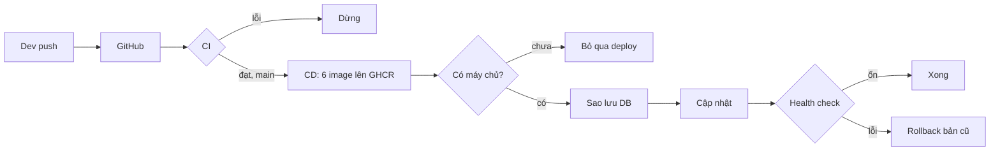

# Báo cáo: chạy thử CI/CD — 29/10/2026

- Repo (private): https://github.com/Gachienmam88/vaxclinic-kiotviet (nhánh mặc định `main`, nhánh dev `feature/phase-01-foundation`)
- Actions: https://github.com/Gachienmam88/vaxclinic-kiotviet/actions
- Hướng dẫn đầy đủ cho chủ doanh nghiệp + kỹ thuật: `docs/deployment-guide.md`

## 1. Tóm tắt cho chủ doanh nghiệp

Từ nay mỗi lần lập trình viên đẩy code lên GitHub:
1. **CI kiểm tra tự động** (~3–6 phút): biên dịch + test backend Java, kiểm tra kiểu/lint/test/build frontend. Lỗi → báo đỏ, dừng.
2. **Khi code vào nhánh `main`**: CD chạy lại CI, đạt thì **đóng gói 6 Docker image** (5 service + web) lên kho riêng GHCR, gắn mã commit.
3. **Triển khai lên máy chủ**: đã viết sẵn (sao lưu DB → cập nhật → kiểm tra sức khỏe → tự quay lại bản cũ nếu lỗi),
   **hiện tự bỏ qua** vì chưa có máy chủ. Khi có VPS chỉ cần thêm 3 secret (xem `docs/deployment-guide.md` mục 3).

```
dev ──push──▶ GitHub ──▶ CI kiểm tra ──đạt + main──▶ CD đóng gói image (GHCR)
                              │ lỗi                         │
                              ▼                             ▼ (khi có máy chủ)
                          báo đỏ, dừng        SSH → sao lưu DB → pull + up → health check
                                                             ├─ ổn  → ghi nhận bản mới
                                                             └─ lỗi → tự quay lại bản cũ
```



## 2. Kết quả chạy thử

| Run | Nhánh / commit | Kết quả |
|---|---|---|
| [CI 40754500978](https://github.com/Gachienmam88/vaxclinic-kiotviet/actions/runs/40754500978) | feature `bb65c2e` | Backend ✓ · Frontend ✗ `npm ci` (lockfile npm 11 vs npm 10) → đã sửa cấu hình |
| [CI 40754914530](https://github.com/Gachienmam88/vaxclinic-kiotviet/actions/runs/40754914530) | feature `7af5c20` | `npm ci` ✓ (đã sửa). Backend ✗ + Frontend ✗ do code đang sửa dở (xem dưới) |
| [CI 40758364114](https://github.com/Gachienmam88/vaxclinic-kiotviet/actions/runs/40758364114) | feature `15c33c8` | **Backend ✓ (mvn verify, 8 lớp test)** · Frontend ✗ type check |
| [CI 40758597854](https://github.com/Gachienmam88/vaxclinic-kiotviet/actions/runs/40758597854) | feature `e5b9268` | Backend ✓ · Frontend ✗ type check (17 lỗi TS) |
| [CD 40758609545](https://github.com/Gachienmam88/vaxclinic-kiotviet/actions/runs/40758609545) | main `e5b9268` | CI trong CD: Backend ✓, Frontend ✗ → **Build image: skipped, Deploy: skipped** — chặn đúng thiết kế (code lỗi không được đóng gói) |

**Kết luận:** cấu hình pipeline đã chạy được (checkout, cache, npm 11, `npm ci`, Maven verify, gate CI→CD). Chưa xanh toàn bộ
vì **lỗi code ứng dụng frontend đang được agent i18n sửa dở** — không thuộc phạm vi CI, không sửa. Bước build/push image GHCR
và job deploy-skip **chưa được chạy thật** (bị gate chặn); sẽ chạy ở lần push `main` đầu tiên có CI xanh.

Lỗi code ứng dụng (run 40758597854, `npx tsc --noEmit`):
```
src/features/hr/employee-form-dialog.tsx(45,19): error TS2345: Argument of type '"employeeForm.toastUpdated"' is not assignable to parameter of type 'MessageKey<...>'   (13 lỗi: key i18n employeeForm.* chưa có trong file messages)
src/features/hr/commission-product-grid.tsx(53,88): error TS2448: Block-scoped variable 't' used before its declaration.
src/features/reports/orders-report.tsx(32,25): error TS2552: Cannot find name 'ReportsT'. Did you mean 'Report'?
```
Trước đó (run 40754914530) còn: `store-access-gate.tsx`/`store-flow-parts.tsx`/`update-choice-dialog.tsx` TS2451 khai báo trùng `t`
(đã được sửa ở run sau) và backend `ShopSettingsAutoConfiguration.java:[21,39] incompatible types: String cannot be converted to RestClient`
(đã được sửa ở run sau). Test frontend chạy cục bộ: 32/33 đạt, 1 lỗi `i18n-keys.test.mjs` "có ít nhất các namespace khung app" (`auth`) — cũng do i18n đang làm.

**Để có run xanh hoàn chỉnh:** khi agent i18n xong → `git add -A && git commit` → `git push origin feature/phase-01-foundation`
→ CI xanh → `git push origin HEAD:main` → CD build 6 image lên GHCR, deploy in "Deploy skipped".

## 3. Việc đã làm

- **An toàn trước khi push**: quét toàn bộ working tree (921 file) + toàn bộ lịch sử (1.633 blob) — không giá trị nào của
  `.env` (DB_PASSWORD, JWT_SECRET, ADMIN_PASSWORD, ENCRYPTION_KEY, RABBITMQ/MINIO_PASSWORD) xuất hiện; không có token GitHub/AWS/
  Slack/private key. `.gitignore` bổ sung: `.env.*` (trừ `.env.example`), `frontend/.env*`, `coverage/`, `*.dump`, `*.sql.gz`,
  `*.tsbuildinfo`, `new prompt/` (thư mục rỗng). `backups/`, `target/`, `node_modules/`, `.next/`, `*.log` đã có.
- **Repo private** tạo bằng `gh repo create`, push nhánh dev + `main`.
- **Snapshot working tree**: HEAD trước đó thiếu cả `frontend/package.json`, nhiều module/migration backend (hook auto-commit
  chỉ ghi từng file sửa bằng Edit) → đã `git add -A` để CI build đúng code thật.
- File mới (không đụng code ứng dụng):

| File | Nội dung |
|---|---|
| `.github/workflows/ci.yml` | backend `mvn -B -ntp verify` (Temurin 17, cache Maven); frontend Node 22 + npm 11.6.2: `npm ci`, `tsc --noEmit`, `eslint . --quiet`, `node --experimental-strip-types --test`, `next build`; artifact báo cáo test; concurrency theo nhánh; tái sử dụng được (`workflow_call`) |
| `.github/workflows/cd.yml` | push `main`/bấm tay → CI → build 6 image matrix (buildx + cache GHA) → `ghcr.io/gachienmam88/vaxclinic-kiotviet-<svc>:<sha>` + `:main` → job deploy (environment `production`), tự skip nếu thiếu secret; bấm tay với `tag` = rollback thủ công |
| `infra/deploy/docker-compose.prod.yml` | Postgres 16 + 5 service + frontend, image GHCR, env từ `.env` trên máy chủ, mem_limit 512m/JVM (`-Xmx256m -XX:+UseSerialGC`, gateway 384m/`-Xmx192m`), cổng chỉ 127.0.0.1 |
| `infra/deploy/deploy.sh` | flock chống chạy trùng; `pg_dump -Fc` từng DB + globals, giữ 20 bản; pull + up; chờ `/actuator/health` x5 + `/login`; ghi `.current_tag`/`.previous_tag`; lỗi → rollback tag trước |
| `frontend/Dockerfile`, `frontend/.dockerignore` | multi-stage, user `node`, `next start -p 3000`, `NEXT_PUBLIC_*` qua build-arg |
| `backend/.dockerignore`, `.gitattributes` | bỏ `target/` khỏi build context; ép LF cho `*.sh`, `*.yml`, Dockerfile |
| `docs/deployment-guide.md` | giải thích cho chủ DN + hướng dẫn thêm VPS, secrets, Caddy HTTPS, khôi phục backup, chi phí |

Backend test chỉ là JUnit thuần (không `@SpringBootTest`/Testcontainers) → CI không cần Postgres.
Redis/RabbitMQ/MinIO có trong compose dev nhưng code chưa dùng → không đưa vào prod (tiết kiệm RAM).

## 4. Sự cố gặp khi chạy thử & cách xử lý

| Sự cố | Nguyên nhân | Xử lý |
|---|---|---|
| Workflow không chạy ở lần push đầu | push khởi tạo ~1.070 commit không sinh sự kiện workflow | push commit kế tiếp → workflow được đăng ký |
| `npm ci`: "Missing @emnapi/runtime from lock file" | lockfile do npm 11.6.2 (máy dev) tạo; Node 22 kèm npm 10 đọc khác | CI + Dockerfile cài `npm@11.6.2` trước `npm ci` (không sửa lockfile) |
| Maven 403 từ Maven Central (1 lần) | lỗi tạm thời phía runner/repo | run sau qua bình thường |
| Cảnh báo action Node 20 deprecated | checkout/setup-java/setup-node v4 | đã nâng lên v5 (upload-artifact giữ v4) |
| Commit snapshot bị gộp vào commit hook `auto: update login-language-select.tsx` | hook auto-commit chạy đúng lúc index đã stage | nội dung đúng; không rewrite history vì hook vẫn đang commit liên tục |

## 5. Việc còn lại / cần quyết định

- Cung cấp VPS (gợi ý 4 GB RAM) + tên miền → thêm secrets `DEPLOY_HOST`, `DEPLOY_USER`, `DEPLOY_SSH_KEY` (+ `DEPLOY_KNOWN_HOSTS`).
- Bật "Required reviewers" cho environment `production` nếu muốn duyệt tay trước khi lên máy chủ.
- Quy trình làm việc: hiện code chỉ lên GitHub khi có người `git push` (repo chưa có push tự động). Nên thống nhất: làm trên
  nhánh → mở PR vào `main` → CI xanh mới merge.
- Repo local không tự push: các commit `auto:` của hook chỉ nằm trên máy; file sửa bằng shell không được hook commit → trước mỗi push cần `git add -A`.

## Câu hỏi chưa giải quyết

- Ai là người được duyệt deploy production?
- Dùng VPS nhà cung cấp nào / tên miền nào? Có cần sao lưu ra ngoài máy chủ (Google Drive/S3) hằng ngày không?
- Có muốn bảo vệ nhánh `main` (bắt buộc PR + CI xanh)? (Branch protection trên repo private cần gói GitHub Pro/Team.)
